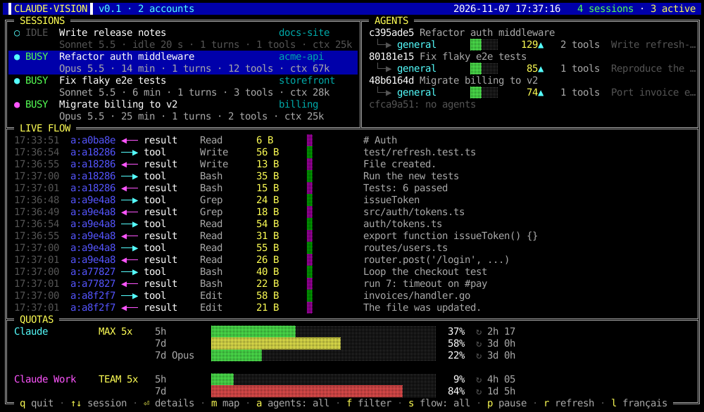
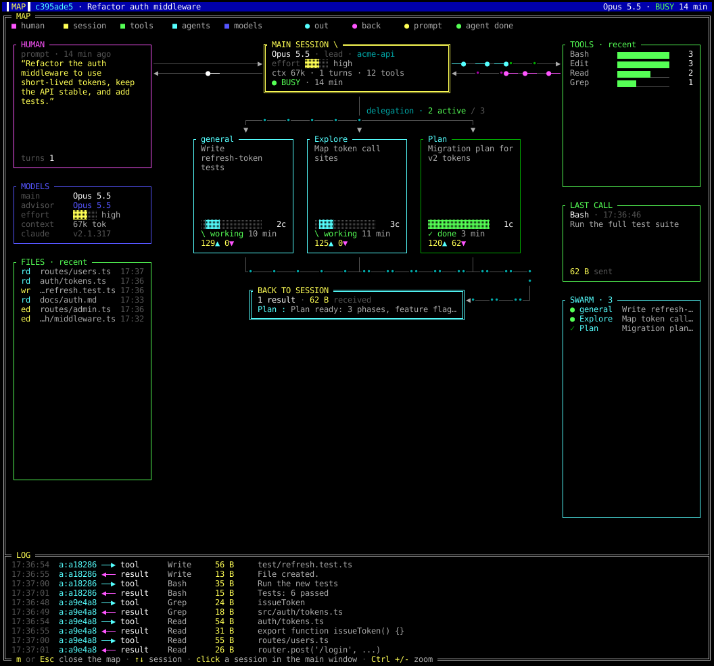

# Claude Vision

[English](README.md) · **Français**

Un tableau de bord rétro, en temps réel, pour tes sessions [Claude Code](https://claude.com/claude-code),
dessiné avec la palette EGA de 16 couleurs. Toutes les sessions en cours, les sous-agents
qu'elles lancent, les données qui circulent et les quotas de ton forfait, d'un seul coup d'œil.



Un clic sur une session ouvre sa **carte animée** : l'humain, la session principale, ses outils
et ses agents délégués, avec des paquets qui voyagent sur les liaisons au fil des événements.



> Outil non officiel, non affilié à Anthropic. Il lit seulement les fichiers que Claude Code
> écrit déjà sur ton ordinateur.

## Téléchargement

- **AppImage Linux (x86_64)** : prends `ClaudeVision-<version>-linux-x86_64.AppImage` dans la
  [dernière version](https://github.com/jguernon/claude-vision/releases/latest), puis :

  ```bash
  chmod +x ClaudeVision-*-linux-x86_64.AppImage
  ./ClaudeVision-*-linux-x86_64.AppImage
  ```

- Aussi sur [jonathanguernon.net](https://jonathanguernon.net/#apps).

Prérequis : Linux avec Wayland ou X11, et une police monospace (DejaVu Sans Mono si elle est
installée). Claude Code doit être installé et connecté.

## Fonctionnement

Tout est lu sur le disque, sans hook ni configuration :

- **Sessions vivantes** : `<config>/sessions/<pid>.json` (nom, statut busy ou idle, dossier),
  validées contre `/proc/<pid>/stat`.
- **Flux d'événements** : le transcript JSONL de chaque session dans `<config>/projects/`, lu
  de façon incrémentale (seuls les octets ajoutés sont lus, réveil par inotify). Même un
  transcript de 100 Mo ne coûte rien.
- **Sous-agents** : le dossier `subagents/` à côté du transcript.
- **Quotas** : l'endpoint OAuth d'usage de Claude, avec le jeton déjà présent dans
  `.credentials.json`. Quand ce jeton d'accès est expiré (il dure environ 8 heures, et personne
  ne le renouvelle quand Claude Code ne tourne qu'à travers Claude Desktop), Claude Vision le
  renouvelle avec le jeton de rafraîchissement, comme Claude Code le fait, et le réécrit dans
  `.credentials.json` (privé, mode 0600). Le jeton n'est jamais affiché et ne part que vers
  Anthropic. L'endpoint
  limite les appels : il est interrogé toutes les 5 minutes, avec un recul progressif jusqu'à
  30 minutes en cas de refus (HTTP 429). Les dernières valeurs sont gardées dans
  `~/.cache/claude-vision/quotas.json` et restent affichées, avec une note, tant que l'API refuse.

Plusieurs comptes sont pris en charge : chaque dossier `~/.claude*` qui contient un
`.credentials.json` est un compte (par exemple `~/.claude` et `~/.claude-travail`).

## Compiler

```bash
cargo build --release          # binaire dans target/release/claude-vision
./install.sh                   # installe le binaire, le lanceur et son icône
./build-appimage.sh            # construit dist/ClaudeVision-<version>-linux-x86_64.AppImage
```

## Utilisation

| Commande | Effet |
|---|---|
| `claude-vision` | ouvre sa propre fenêtre et rend la main au terminal |
| `claude-vision --window` | ouvre la fenêtre au premier plan (utilisé par le lanceur) |
| `claude-vision --map` | ouvre aussi la carte animée dès le lancement |
| `claude-vision --tui` | affiche le tableau de bord dans le terminal courant |
| `claude-vision --lang fr\|en` | choisit la langue |
| `claude-vision --snapshot F.png [COLS LIGNES]` | rend une image PNG du tableau de bord, sans fenêtre |
| `claude-vision --snapshot-map F.png [COLS LIGNES] [--session ID]` | rend une image PNG d'une carte |

La fenêtre est native (Wayland ou X11). Le texte vient de la police monospace, et les bordures
doubles, blocs et trames ░▒▓ sont tracés pixel par pixel comme sur une carte EGA.
`Ctrl +`, `Ctrl -` et `Ctrl 0` règlent la taille des caractères de la fenêtre active ; chaque
fenêtre retient sa dernière taille (dans `~/.config/claude-vision/zoom`).

L'interface parle français et anglais. La langue vient de `--lang`, puis de
`CLAUDE_VISION_LANG`, puis de `~/.config/claude-vision/lang`, puis de la langue du système.
La touche `l` bascule et mémorise le choix.

### Touches

| Touche | Action |
|---|---|
| `q`, `Esc`, `Ctrl-C` | quitter (Esc ferme d'abord le détail) |
| `↑` `↓`, clic, molette | choisir une session |
| `⏎` ou `d` | détail de la session (prompt, agents, transcript) |
| `m` | ouvrir ou fermer la carte animée |
| `a` | agents : toutes les sessions ou la session choisie |
| `f` | filtre du flux : tous, outils, agents, modèle |
| `s` | flux : tout ou la session choisie seulement |
| `p` | pause du flux |
| `r` | rafraîchir sessions et quotas |
| `l` | basculer entre français et anglais |
| `Tab` | changer de compte (chaque compte tour à tour, puis tous) |

### Plusieurs comptes et instances

Avec plusieurs comptes, la fenêtre montre un compte à la fois (ses sessions, ses agents, son
flux et son quota) ; `Tab` passe au compte suivant, puis à tous les comptes.

On peut aussi lancer une deuxième copie de l'app réservée à un compte, avec sa propre identité
d'application (GNOME peut alors la placer sur son propre espace de travail) et sa couleur de
bandeau :

```bash
claude-vision --instance work --account work --accent red
packaging/install-instance.sh work work red    # ajoute le lanceur et l'icône « Claude Vision WORK »
```

`--account` garde le compte dont le libellé ou le dossier contient le texte donné. Les instances
partagent le cache des quotas : en lancer plusieurs ne multiplie pas les appels à l'API. Seule
l'instance principale publie les données de l'indicateur de la barre du haut.

## Lecture de l'écran

- **SESSIONS** : puce colorée par compte, `BUSY` ou `IDLE`, nom et projet. En dessous : le
  modèle, la durée, le nombre de prompts (tours), d'appels d'outils et la taille du contexte.
- **AGENTS** : l'arbre des sous-agents. Une barre animée veut dire que l'agent travaille,
  `terminé ✓` donne sa durée et les octets reçus (▼), `en attente` signifie aucune activité
  depuis plus d'une minute.
- **FLUX TEMPS RÉEL** : `──▶` (cyan) ce qui sort de la session (appel d'outil, lancement
  d'agent), `◀──` (magenta) ce qui y entre (résultat, notification, réponse du modèle, prompt).
  La barre est logarithmique sur la taille. Les lignes `a:` viennent d'un sous-agent.
- **QUOTAS** : une ligne par fenêtre renvoyée par l'API (5h, 7j, 7j par modèle). Vert sous
  50 %, jaune sous 80 %, rouge au-delà, avec le délai avant la remise à zéro.

### Carte animée

La carte est pensée pour une fenêtre haute (150 × 84 cellules par défaut) et s'adapte à la taille.

- **HUMAIN** à gauche (dernier prompt), puis **MODÈLES** (principal, conseiller, effort) et
  **FICHIERS** lus ou modifiés par la session et ses agents.
- **SESSION PRINCIPALE** au centre, **OUTILS** récents, **DERNIER APPEL** et **ESSAIM** (tous
  les agents, actifs en tête) à droite.
- Les **agents** délégués remplissent une grille sur autant de rangées que la hauteur le
  permet. La délégation descend par la gauche, les retours remontent par la droite jusqu'à
  **RETOUR À LA SESSION**.
- Chaque événement du transcript devient un paquet `●` qui voyage sur sa liaison : prompt en
  jaune, réponse en blanc, appel d'outil en cyan, résultat en magenta, lancement d'agent en
  cyan, agent terminé en vert. Les points `•` défilent sur les liaisons actives.
- Le **JOURNAL** en bas reprend les derniers événements de la session et de ses agents.

## Indicateur dans la barre du haut (GNOME)

`tray-extension/install.sh` installe l'extension GNOME Shell `claude-vision-tray@jguernon`.
Tant que Claude Vision est ouvert, elle affiche le quota 7 jours de chaque compte dans la barre
du haut, avec les mêmes couleurs et une barre courte, en lisant `~/.cache/claude-vision/tray.json`.
Elle n'appelle jamais l'API et reste toujours la première à gauche des icônes système. Sous
Wayland, il faut se déconnecter puis se reconnecter après l'avoir installée ou mise à jour.

## Licence

[MIT](LICENSE) © 2026 Jonathan Guernon.
