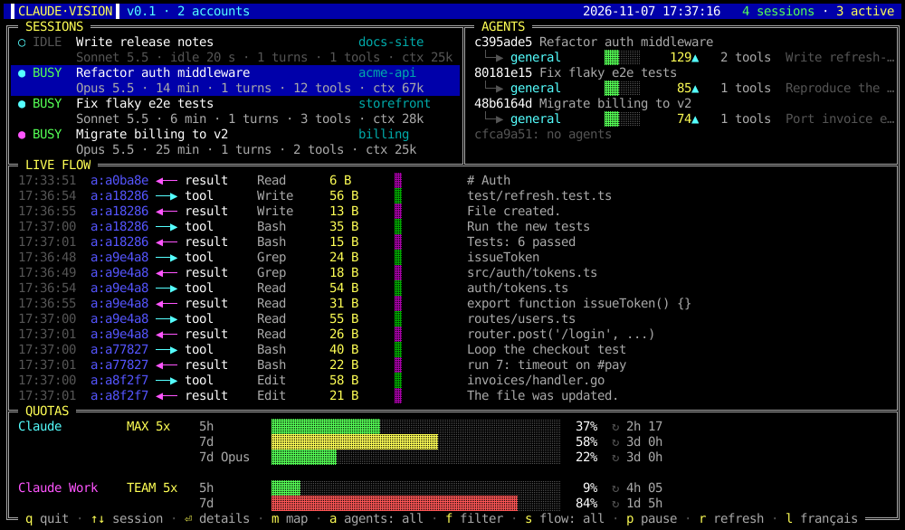
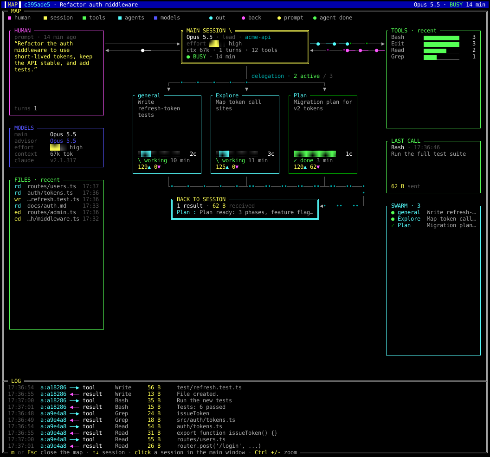

# Claude Vision

**English** · [Français](README.fr.md)

A live, retro dashboard for your [Claude Code](https://claude.com/claude-code) sessions, drawn
in the 16-color EGA palette. See every running session, the sub-agents they spawn, the data
going back and forth, and your plan's usage quotas, all at a glance.



Click a session to open its **animated map**: the human, the main session, its tools and its
delegated agents, with packets travelling along the links as events happen.



> Unofficial tool, not affiliated with Anthropic. It only reads files Claude Code already
> writes on your computer.

## Download

- **Linux AppImage (x86_64)**: grab `ClaudeVision-<version>-linux-x86_64.AppImage` from the
  [latest release](https://github.com/jguernon/claude-vision/releases/latest), then:

  ```bash
  chmod +x ClaudeVision-*-linux-x86_64.AppImage
  ./ClaudeVision-*-linux-x86_64.AppImage
  ```

- Also listed on [jonathanguernon.net](https://jonathanguernon.net/#apps).

Requirements: Linux with Wayland or X11, and a monospace font (DejaVu Sans Mono is used when
available). Claude Code must be installed and signed in.

## How it works

Everything is read from disk, with no hooks and no configuration:

- **Live sessions**: `<config>/sessions/<pid>.json` (name, busy or idle, folder), checked
  against `/proc/<pid>/stat`.
- **Event flow**: each session's JSONL transcript in `<config>/projects/`, read incrementally
  (only new bytes are read, woken up by inotify), so even 100 MB transcripts cost nothing.
- **Sub-agents**: the `subagents/` folder next to the transcript.
- **Quotas**: Claude's OAuth usage endpoint, using the token already in `.credentials.json`.
  When that access token has expired (it lasts about 8 hours, and nobody renews it when Claude
  Code only runs through Claude Desktop), Claude Vision renews it with the refresh token, like
  Claude Code itself does, and writes it back to `.credentials.json` (private, mode 0600). The
  token is never displayed and only goes to Anthropic. The endpoint is rate-limited, so it
  is polled every 5 minutes, backing off up to 30 minutes on HTTP 429. The last values are
  cached in `~/.cache/claude-vision/quotas.json` and stay on screen, with a note, while the
  API refuses.

Several accounts are supported: every `~/.claude*` folder holding a `.credentials.json` is one
account (for example `~/.claude` and `~/.claude-work`).

## Build from source

```bash
cargo build --release          # binary in target/release/claude-vision
./install.sh                   # installs the binary, the app launcher and its icon
./build-appimage.sh            # builds dist/ClaudeVision-<version>-linux-x86_64.AppImage
```

## Usage

| Command | Effect |
|---|---|
| `claude-vision` | opens its own window and returns to the shell |
| `claude-vision --window` | opens the window in the foreground (used by the launcher) |
| `claude-vision --map` | also opens the animated map at startup |
| `claude-vision --tui` | draws the dashboard inside the current terminal |
| `claude-vision --lang fr\|en` | picks the language |
| `claude-vision --snapshot F.png [COLS ROWS]` | renders a PNG of the dashboard, no window |
| `claude-vision --snapshot-map F.png [COLS ROWS] [--session ID]` | renders a PNG of a map |

The window is native (Wayland or X11). Text comes from the monospace font, while the double
borders, blocks and ░▒▓ shades are drawn pixel by pixel like on an EGA card.
`Ctrl +`, `Ctrl -` and `Ctrl 0` set the character size of the active window; each window
remembers its last size (in `~/.config/claude-vision/zoom`), and the map uses the main window's
size until it gets its own.

The interface speaks English and French. The language comes from `--lang`, then
`CLAUDE_VISION_LANG`, then `~/.config/claude-vision/lang`, then the system locale. Press `l`
to switch; the choice is remembered.

### Keys

| Key | Action |
|---|---|
| `q`, `Esc`, `Ctrl-C` | quit (Esc closes the details panel first) |
| `↑` `↓`, click, mouse wheel | select a session |
| `⏎` or `d` | session details (prompt, agents, transcript) |
| `m` | open or close the animated map |
| `a` | agents: all sessions or the selected one |
| `f` | flow filter: all, tools, agents, model |
| `s` | flow: everything or the selected session only |
| `p` | pause the flow |
| `r` | refresh sessions and quotas |
| `l` | switch between English and French |
| `Tab` | switch account (each account in turn, then all of them) |

### Several accounts and instances

With several accounts, the window shows one account at a time (sessions, agents, flow and its
own quota); `Tab` switches to the next one, then to all of them.

You can also run a second copy of the app dedicated to one account, with its own app identity
(so GNOME can put it on its own workspace) and its own banner color:

```bash
claude-vision --instance work --account work --accent red
packaging/install-instance.sh work work red    # adds a "Claude Vision WORK" launcher and icon
```

`--account` keeps the account whose label or folder contains the given text. Instances share
the quota cache, so running several of them does not multiply calls to the API. Only the main
instance publishes the top bar indicator's data.

## Reading the screen

- **SESSIONS**: a dot colored by account, `BUSY` or `IDLE`, name and project. Below: model,
  duration, number of prompts (turns), tool calls and context size.
- **AGENTS**: the sub-agent tree. An animated bar means the agent is working, `done ✓` shows
  its duration and the bytes it returned (▼), `waiting` means no activity for over a minute.
- **LIVE FLOW**: `──▶` (cyan) is what leaves the session (tool call, agent launch), `◀──`
  (magenta) is what comes back (result, notification, model reply, prompt). The bar is
  logarithmic in size. Lines starting with `a:` come from a sub-agent.
- **QUOTAS**: one line per window returned by the API (5h, 7d, 7d per model). Green under
  50 %, yellow under 80 %, red above, with the time left before the reset.

### Animated map

The map is designed for a tall window (150 × 84 cells by default) and adapts to its size.

- **HUMAN** on the left (last prompt), then **MODELS** (main, advisor, effort) and **FILES**
  read or edited by the session and its agents.
- **MAIN SESSION** in the middle, recent **TOOLS**, **LAST CALL** and **SWARM** (every agent,
  active ones first) on the right.
- Delegated **agents** fill a grid with as many rows as the height allows. Delegation goes
  down on the left, results come back on the right, to **BACK TO SESSION**.
- Every transcript event becomes a `●` packet travelling along its link: prompt in yellow,
  reply in white, tool call in cyan, result in magenta, agent launch in cyan, finished agent
  in green. `•` dots scroll along active links.
- The **LOG** at the bottom lists the latest events of the session and its agents.

## Top bar indicator (GNOME)

`tray-extension/install.sh` installs the GNOME Shell extension `claude-vision-tray@jguernon`.
While Claude Vision is open, it shows each account's 7-day quota in the top bar, with the same
colors and a short bar, by reading `~/.cache/claude-vision/tray.json`. It never calls the API
and always sits first on the left of the system icons. On Wayland, log out and back in after
installing or updating it.

## License

[MIT](LICENSE) © 2026 Jonathan Guernon.
